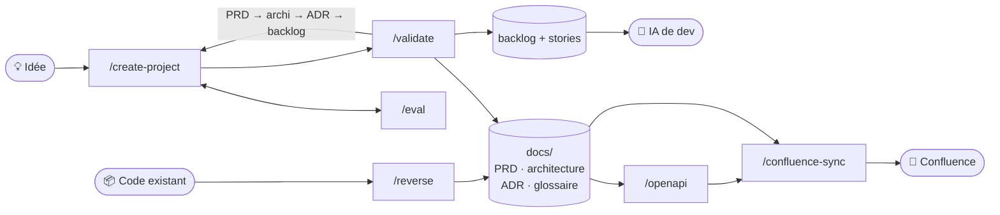

<div align="center">

# 🧭 sohub-plugins-spec

**De l'idée au backlog prêt à coder, ou du code existant à une doc Confluence sourcée ligne par ligne.**

*Plugin Claude Code de cadrage de projet : PRD, architecture, ADR, user stories, contrats OpenAPI et publication Confluence, pour que l'IA qui développera n'ait rien à deviner ni à inventer.*

[](.claude-plugin/plugin.json)
[](LICENSE)
[](https://docs.claude.com/en/docs/claude-code/plugins)
[](#-stack--technos)
[](#-stack--technos)
[](#-stack--technos)
[](#-skills)
[](#)

[Démarrage rapide](#-démarrage-rapide) · [Skills](#-skills) · [Stack](#-stack--technos) · [Documents produits](#-documents-produits) · [Conception](#-conception) · [Licence](#-licence)

</div>

---

## ✨ En bref

Plugin Claude Code de **cadrage de projet**. On part d'une idée (ex. une app Pomodoro) et on écrit tout noir sur blanc — PRD, architecture, ADR, puis backlog de user stories — pour que l'IA qui développera l'application n'ait rien à deviner ni à inventer.

Il documente aussi un **projet existant** par reverse engineering (`/reverse`) : le code est cartographié avec [Code Review Graph](https://github.com/tirth8205/code-review-graph), trois agents de recherche l'explorent en parallèle (structure, usages, données) et proposent une structure de documentation, puis des agents rédigent en parallèle les mêmes documents (sans ADR : sur un projet existant, les décisions sont déjà prises), chaque affirmation sourcée dans le code.

| | Projet neuf — `/create-project` | Projet existant — `/reverse` |
|---|---|---|
| **Point de départ** | Une idée, éventuellement des documents (diagrammes, specs, notes) | Un dépôt de code |
| **Méthode** | Boucle questions → choix → rédaction → eval | Graphe du code → 3 explorations parallèles → cartographie → rédaction parallèle |
| **Documents** | PRD, architecture, ADR, glossaire, backlog et stories | PRD, architecture, glossaire (mêmes structures, sans ADR) |
| **Garantie** | Chaque décision répond à un besoin écrit du PRD | Chaque affirmation porte sa preuve `fichier:ligne`, vérifiée par script |
| **Ensuite** | `/openapi` · `/confluence-sync` vers Confluence · `/create-ticket` pour chaque évolution | `/openapi` · `/create-project` pour affiner · `/create-ticket` · `/confluence-sync` vers Confluence |



## 🚀 Démarrage rapide

Installer depuis GitHub, via la marketplace du dépôt :

```
/plugin marketplace add ouakeds/sohub-plugins-kickoff
/plugin install sohub-plugins-spec@sohub-plugins-spec-dev
```

Puis, dans Claude Code :

```
/install                             # vérifie et installe les dépendances
/create-project une app Pomodoro     # cadrer un projet neuf
/reverse ./mon-depot                 # documenter un projet existant
```

Pour développer le plugin, voir [Tester en local](#-tester-en-local).

## 🧩 Skills

| Commande | Rôle |
|----------|------|
| `/create-project [idée] [chemins…]` | Une itération de cadrage : questions de l'agent de cadrage → vos choix → rédaction du document courant → eval automatique → relancer / valider / arrêter. Avec des chemins de documents existants (diagrammes, specs, notes — fichiers ou dossiers), le premier lancement rédige directement le PRD à partir d'eux. |
| `/reverse [dépôt]` | Documente un projet existant. Construit (ou met à jour) le graphe du code avec Code Review Graph, en tire un digest (communautés, flux d'exécution, points d'entrée, dépendances, zones à risque), puis **trois agents de recherche explorent le code en parallèle** (Sonnet ; structure et composants ; usages, CU et glossaire ; données, contrats, contraintes et choix techniques ; le digest répartit les fichiers à lire entre eux) et un quatrième (Opus) consolide leurs résultats en une **cartographie**, un index court : identifiants des composants, cas d'utilisation, données, contrats, choix techniques constatés, glossaire, zones d'incertitude ; le détail reste dans les explorations. Après validation de cette structure par vos choix, **deux agents rédigent en parallèle** le PRD d'une part, architecture + glossaire d'autre part (composants en tableau, flux d'intégration, index des contrats), avec **exactement la même structure qu'un projet cadré avec `/create-project`**, en `brouillon`, chaque élément suivi de sa preuve `*(déduit : fichier:ligne)*` ; ce que le code ne dit pas devient question ouverte (10 au plus par document, les autres restent dans la cartographie). **Pas d'ADR ni de décision à trancher** : les décisions sont déjà prises ; les choix techniques constatés sont décrits dans l'architecture (§ 6), sans question sur leur raison. Un ADR ne naît ensuite, avec `/create-project`, que d'une nouvelle décision (changer un choix existant). **Pas d'eval** (les incohérences sont celles du code existant) : un script vérifie que chaque preuve `fichier:ligne` existe. Puis `/openapi` pour les spécifications des API, `/create-project` pour affiner ou `/confluence-sync` pour publier. N'écrase jamais un document existant. |
| `/openapi [projet] [CTR-xx…]` | Produit ou met à jour les spécifications machine des contrats listés au § 5.2 de l'architecture, dans `docs/contrats/` : OpenAPI 3.1 (API HTTP exposée, et chaque API tierce appelée, limitée aux opérations utilisées), AsyncAPI 3.0 (événements, file de messages), JSON Schema (format de fichier). Extraites du code pour un projet existant (preuve `x-source` par opération), conçues d'après le PRD pour un cadrage neuf (`x-besoins`, propositions `x-propose`). Validées par `redocly` / `asyncapi` ; l'index du § 5.2 est mis à jour. Toutes les specs ont une URL de base absolue et des exemples de corps, pour être importées dans Postman telles quelles. |
| `/eval` | Relance à la main une passe d'évaluation des points d'ombre. |
| `/confluence-sync [projet] [--refaire]` | Publie la documentation sur Confluence sous une page racine `<Projet>`. **Tout le dossier `docs/` est publié, et lui seul** (sauf `docs/eval/`) : ni le code, ni le backlog, ni aucun fichier hors de `docs/`. Un agent **`layout`** lit ces documents (PRD, architecture, glossaire, ADR, spécifications, et tout autre document de `docs/`) et l'arborescence cible du plugin (`templates/confluence-tree.md`) : page d'arrivée (présentation, sommaire, démarrage en local, variables d'environnement, structure du code, conventions, tests), Vue d'ensemble, Fonctionnel, Architecture découpée en Données, Flux, Interfaces (une page Contrat par spécification, spécification complète dans un bloc repliable) et Services externes, Décisions (ADR) — projet cadré seulement —, Points ouverts et dette, Glossaire. Il décide du contenu de chaque page (sélection, déplacement, fusion des doublons, nettoyage des traces du processus) sans rien inventer ni perdre d'identifiant. Le script `skills/confluence-sync/resolve.py` vérifie son rendu (aucun identifiant métier perdu, ni « § », ni titre numéroté, ni identifiant de processus), résout les liens entre pages et insère les spécifications depuis le disque, calcule les empreintes, prépare les lots et fusionne les résultats. La mise en page n'est refaite que si les sources ont changé (ou avec `--refaire`). Publication en deux temps : squelette des pages nouvelles et remise en ordre de l'arborescence, puis corps publiés **en parallèle** par des agents `publisher` (6 au maximum), avec le statut natif de chaque page. Diagrammes Mermaid rendus en PNG (mermaid-cli, en parallèle) et insérés en image avec leur source repliée ; chaque spécification est jointe à sa page Contrat (fichier téléchargeable). L'envoi des fichiers passe par `resolve.py upload`, qui contrôle chaque commande d'envoi (fichier de `docs/`, adresse du site, options) avant de l'exécuter ; il exige une règle de permission pour cette seule commande (voir `skills/confluence-sync/SKILL.md`). Le backlog et les stories restent dans le dépôt. Proposé en fin de `/validate`. Nécessite le connecteur Atlassian, et mermaid-cli pour les images. |
| `/install` | Vérifie les dépendances (python3 et PyYAML, curl, unzip, Node.js, mermaid-cli, son navigateur headless et ses bibliothèques système, linters OpenAPI / AsyncAPI, uv et Code Review Graph, connecteur Atlassian) et installe celles qui manquent, avec votre accord. Proposé par `/confluence-sync` si le rendu des diagrammes est impossible, par `/reverse` si Code Review Graph manque, et par `/openapi` si le linter manque. |
| `/compare [projets…]` | Compare plusieurs runs du même projet (qualité, temps, coût) à partir de leurs métriques. |
| `/validate` | Valide le document courant et passe à l'étape suivante (PRD → architecture → ADR → backlog), puis génère les documents suivants (architecture + ADR + index, puis backlog + stories) avec les propositions de l'agent, marquées *(proposé)* ; ils seront évalués à la fin du `/create-project` suivant. Avertit s'il reste des points bloquants, sans jamais bloquer. |
| `/create-ticket <description \| clé Jira> [chemins…]` | Cadre une **évolution** (feature ou bugfix) sur un projet déjà documenté (cadré avec `/create-project` ou rétro-documenté avec `/reverse`), en spec-driven. La demande vient d'une description libre ou d'un ticket Jira (lu avec le connecteur Atlassian, sans le modifier). Même boucle que `/create-project` : analyse d'impact par l'agent de cadrage (type feature / bug ; pour un bug, écart à la spec ou cas non spécifié ; documents et identifiants touchés) → vos choix → mise à jour **en place** des documents touchés (PRD, architecture, nouvel ADR si une décision est prise, glossaire) et création des US du ticket au statut `à cadrer` → eval du ticket → relancer / valider le ticket (US `à faire`, ADR `accepté`, ADR remplacé déclassé) / arrêter / abandonner (les documents reviennent à l'instantané pris au début du ticket). Une US existante touchée par le ticket repasse `à cadrer` jusqu'à la validation. |

## 🛠 Stack / technos

| Domaine | Technologies | Où |
|---|---|---|
| **Plateforme** | [Claude Code](https://docs.claude.com/en/docs/claude-code) — plugin : 9 skills (slash commands), 5 agents, 2 hooks (`SubagentStop`, `Stop`), marketplace | `.claude-plugin/`, `skills/`, `agents/`, `hooks/` |
| **Modèles** | Claude Sonnet (explorations parallèles), Claude Opus (consolidation de la cartographie) | `agents/` |
| **Scripts** | Python 3 (+ PyYAML) | `hooks/metrics.py` (métriques, coûts, comparaison de runs), `skills/reverse/graph_digest.py` (digest du graphe), `skills/reverse/check_refs.py` (vérification des preuves `fichier:ligne`), `skills/eval/check_tasks.py` (contrôle des plans de tâches), `skills/confluence-sync/resolve.py` (contrôle du rendu, liens, empreintes, lots) |
| **Analyse de code** | [Code Review Graph](https://github.com/tirth8205/code-review-graph) (installé avec `uv`) | `/reverse` |
| **Contrats** | OpenAPI 3.1, AsyncAPI 3.0, JSON Schema — validés par `redocly` et `asyncapi` | `/openapi` → `docs/contrats/` |
| **Diagrammes** | Mermaid, rendus en PNG par mermaid-cli (Node.js, Chrome headless via puppeteer) | `/confluence-sync` |
| **Publication** | Confluence, via le connecteur Atlassian (MCP) ; pièces jointes envoyées par `curl` à travers `resolve.py upload`, qui contrôle chaque envoi | `/confluence-sync` |
| **Formats lus** | Texte, Markdown, Mermaid, PlantUML, PDF, images | `/create-project [chemins…]` |

## 📂 Documents produits

Chaque projet cadré a son propre dossier, créé par `/create-project` dans le répertoire courant (ex. `pomodoro/`). Le nom du répertoire courant n'est jamais utilisé comme information sur le projet.

Les documents existants passés en argument (sources) sont mémorisés dans le champ `sources:` du PRD : ils restent lus par l'agent de cadrage (analyse, génération de l'architecture et des ADR) et par l'évaluateur. Formats lus : texte, markdown, mermaid, plantuml, PDF, images ; les autres (`.docx`, `.pptx`…) sont signalés et ignorés.

```
<projet>/docs/
  prd.md               # Besoins et exigences
  architecture.md      # Vue d'architecture (composants, données, flux d'intégration, index des contrats…)
  contrats/            # Spécifications des contrats (/openapi) : *.openapi.yaml, *.asyncapi.yaml, *.schema.json
  adr/index.md         # Index des décisions
  adr/NNNN-*.md        # Une décision par fichier
  glossaire.md         # Vocabulaire du projet
  eval/AAAA-MM-JJ-HHMMSS.md  # Une passe d'évaluation par fichier (historique)
<projet>/.sohub-plugin/
  backlog.md           # User stories, priorités, dépendances et statut de dev de chaque US
  stories/US-NNN-*.md  # Une story autonome par fichier : critères d'acceptation, plan de tâches en vagues parallélisables
  tasks.md             # Contrôle mécanique des plans de tâches (check_tasks.py, lancé par l'eval ; tasks-<ID>.md pour un ticket)
  tickets/<ID>/        # Instantané des documents au début d'un ticket (abandon possible), supprimé à la validation
  metrics.jsonl        # Métriques (automatique, source de vérité) : une ligne par intervention
  metrics.md           # Vue lisible des métriques, régénérée à chaque ajout
  reverse/graphe.md    # Projet existant : digest du graphe de code
  reverse/exploration/ # Projet existant : résultats des trois explorations parallèles
  reverse/cartographie.md  # Projet existant : structure de documentation proposée puis validée
  reverse/preuves.md   # Projet existant : vérification des références fichier:ligne
  sync/                # Fichiers de travail de /confluence-sync (corps de page, lots, résultats)
<projet>/.code-review-graph/  # Base du graphe (Code Review Graph, ignoré par git)
```

**Projet existant.** Pour `/reverse`, le projet est le dépôt de code lui-même : les documents sont écrits dans son `docs/`. Ils portent `origine: rétro` ; le champ `sources:` du PRD cite le dépôt avec sa branche et son commit. Les agents ne relisent pas tout le dépôt ensuite : seulement les fichiers cités par les marqueurs `*(déduit : …)*`, dont `check_refs.py` vérifie l'existence en fin de `/reverse` (et l'évaluateur par sondage, lors d'un `/create-project`). `docs/adr/index.md` reste vide : les choix constatés sont dans la table « Choix techniques constatés » de l'architecture. Nécessite Code Review Graph (`uv tool install "code-review-graph[communities]"`, ou `/install`).

**Backlog.** Le backlog est généré à la validation des ADR, affiné par `/create-project`, puis validé. Chaque story porte un **plan de tâches** découpé en **vagues** pour préparer un développement parallèle : vague 1 = contrats, puis tests et code en parallèle, dernière vague = intégration ; deux tâches d'une même vague n'écrivent jamais le même fichier. Le backlog regroupe les US en **lots** développables en même temps. Ensuite, les agents de dev suivent ses « Règles de suivi » : une tâche est prenable quand son US est dans le lot courant et que ses dépendances sont `fait` ; l'agent n'écrit que ses « Fichiers écrits » ; quand plusieurs agents travaillent en parallèle, un seul (l'orchestrateur du développement) tient les statuts. Le découpage ne concerne que le nouveau : backlog du cadrage initial et US de `/create-ticket` (`/reverse` décrit l'existant, sans backlog).

**Évolutions (spec-driven).** Une fois le projet documenté, chaque nouvelle demande passe par `/create-ticket` : la spec est mise à jour avant le code. Il n'y a pas de document de ticket à part : PRD, architecture, ADR et glossaire sont modifiés en place (les statuts `validé` ne changent pas), chaque modification est tracée dans les journaux avec l'identifiant du ticket (clé Jira ou `TK-NNN`, ex. `PROJ-123/B1`), et les US du ticket portent `Ticket : <ID>`. Tant que le ticket n'est pas validé, ses US restent `à cadrer` et l'IA de dev ne les prend pas. Un bug qui viole un EF ou un critère existant ne change pas le PRD : il donne une US `bug` qui cite l'exigence et commence par un test de non-régression ; un bug sur un cas non spécifié ajoute d'abord la règle ou le critère au PRD.

**Pas de fichier d'état** : l'étape courante se déduit du champ `statut` (`brouillon` / `validé`) en tête de `prd.md`, `architecture.md`, `adr/index.md` et `.sohub-plugin/backlog.md`. Le champ `maj` donne la date de dernière rédaction ; il permet de savoir si le dernier eval est à jour.

**Règles communes** aux documents : les identifiants (EF-xx, CU-xx, US-xxx, E-xxx…) ne sont jamais renumérotés ni réutilisés, un point non tranché porte un marqueur `[À CLARIFIER : Q-xx]` à l'endroit concerné en plus de sa question ouverte, une question tranchée est intégrée au document puis retirée, et chaque décision de l'utilisateur est tracée dans un journal des décisions. L'architecture passe trois contrôles de conception (simplicité, anti-abstraction, intégration d'abord) ; tout écart est justifié dans un « Suivi de la complexité ».

### 📊 Métriques

Deux hooks remplissent `<projet>/.sohub-plugin/metrics.jsonl` à partir des transcripts (jamais à partir de ce que disent les agents) :
- `SubagentStop` : une ligne par intervention d'agent — acteur, modèle · effort, mode, étape, tâche, début, fin, durée, tours, outils, tokens (entrée, cache écrit, cache lu, sortie), coût d'entrée, coût de sortie, et la qualité (points d'ombre et bloquants du dernier eval) pour les evals ;
- `Stop` : le travail de l'orchestrateur (session principale) pendant le tour, découpé par itération.

`metrics.md` est régénéré à chaque ajout : résumé du run, tableau par itération (durée, coûts, points ouverts), moyennes par acteur, mode et modèle, et le détail des interventions. Les coûts sont estimés aux tarifs de l'API Anthropic (table `PRICES` de `hooks/metrics.py`, à mettre à jour si les tarifs changent).

Pour comparer la qualité, le temps et le coût, génère le même projet dans plusieurs dossiers (ex. `pomodoro-v1`, `pomodoro-v2`), puis lance `/compare pomodoro-v1 pomodoro-v2` (ou `python3 hooks/metrics.py compare …`). Nécessite `python3`.

## 🧠 Conception

> **Principe.** Tout ce qui est attendu doit être écrit noir sur blanc : l'IA qui développera ne doit rien avoir à deviner ni à inventer.

**Échanges.** L'utilisateur ne parle qu'à l'orchestrateur (la commande), jamais directement aux agents. L'orchestrateur invoque l'agent de cadrage, qui précise et challenge la demande, puis lui remonte ses points bloquants, ses zones de flou et ses propositions. L'orchestrateur les traduit pour l'utilisateur, avec des options, et l'utilisateur tranche. Un seul agent de cadrage porte à la fois la casquette de celui qui challenge et de celui qui propose ; un second agent « copilote » reste en réserve si, à l'usage, il mélange trop les deux.

**Agent de cadrage.** C'est un product owner sceptique, qui adopte le point de vue du client et de l'utilisateur final. Il traque les besoins réels, pas les fonctionnalités supposées : tout besoin non justifié est écarté tant qu'il n'a pas prouvé un vrai usage (à qui sert la fonctionnalité, dans quel usage concret). Il pose des questions ciblées et groupées, saute celles dont la réponse est connue, reformule pour vérifier, pointe les contradictions, et n'invente jamais une réponse à la place de l'utilisateur.

**La boucle.**
1. Avec `/create-project`, l'agent cadre la demande, l'utilisateur tranche, et le document de l'étape courante est rédigé ou affiné.
2. L'eval se lance automatiquement en fin d'itération. C'est un regard à part : on produit, puis on audite. L'eval porte sur tous les documents qui existent déjà, et l'absence d'un document attendu est elle-même un point d'ombre.
3. L'utilisateur choisit alors entre trois suites :
   - **relancer** : une nouvelle itération part des points d'ombre du dernier eval ;
   - **valider** (`/validate`) : on passe à l'étape suivante, avec un simple avertissement s'il reste des points bloquants ;
   - **arrêter** : les documents restent en l'état, et l'on reprend plus tard.

**Ordre de génération.** On écrit d'abord le PRD, puis l'architecture, puis les ADR, puis le backlog d'US. Chaque décision d'architecture, chaque ADR et chaque US répond à un besoin écrit dans le PRD. Rien n'est jamais bloqué automatiquement : c'est toujours l'humain qui décide quand passer à l'étape suivante.

**Backlog d'US** (inspiré de spec-kit et BMAD) :
- Le découpage est vertical : une US apporte une valeur utilisateur testable de bout en bout. Les US P1 forment le MVP et couvrent tous les EF V1.
- Chaque story contient :
  - son récit ;
  - les besoins PRD, architecture et ADR auxquels elle répond ;
  - ses critères d'acceptation, reliés aux EF ;
  - son plan de tâches : un tableau (ID, tâche, vague, dépendances, fichiers écrits, à lire, CA, « terminé quand », statut, agent), sous-tâches sur un seul niveau, et sa parallélisation (vagues, parallélisme maximal, chemin critique) ;
  - sa définition de terminé.
- Le statut de chaque US vit uniquement dans le tableau du backlog ; celui de chaque tâche, dans le plan de tâches de sa story.
- `skills/eval/check_tasks.py` vérifie mécaniquement les plans (dépendances sans cycle et vers des vagues antérieures, fichiers écrits deux fois dans une vague, CA sans tâche, sous-tâches, lots d'US) avant l'évaluateur ; ses anomalies sont bloquantes à l'étape BACKLOG et pour un ticket (contrôle « prêt à paralléliser »).
- À l'étape BACKLOG, l'évaluateur fait le contrôle « prêt à développer ». Sont bloquants : un EF V1 sans US, une US sans besoin, une dépendance cassée.

## 🗂 Structure du plugin

```
.claude-plugin/
  plugin.json          # Manifeste du plugin
  marketplace.json     # Marketplace locale pour tester le plugin
skills/create-project/   # Orchestrateur : une itération de la boucle de cadrage
skills/eval/             # Passe d'évaluation (lancée aussi en fin d'itération) (+ check_tasks.py)
skills/validate/         # Validation de l'étape courante
skills/create-ticket/    # Cadrage d'une évolution (feature, bugfix) sur un projet documenté
skills/confluence-sync/  # Synchronisation des documents vers Confluence (+ resolve.py)
skills/install/          # Diagnostic et installation des dépendances (mermaid-cli, Code Review Graph, linters…)
skills/reverse/          # Rétro-documentation d'un projet existant (+ graph_digest.py, check_refs.py)
skills/openapi/          # Spécifications OpenAPI / AsyncAPI / JSON Schema des contrats
skills/compare/          # Comparaison de runs (qualité, temps, coût)
agents/scoping.md        # Agent de cadrage : product owner sceptique (analyse, rédaction, proposition)
agents/evaluator.md      # Auditeur : liste les points d'ombre dans docs/eval/
agents/researcher.md     # Agent de recherche : explore, cartographie un projet existant et rédige sa documentation
agents/layout.md         # Agent de mise en page : transforme les documents en pages Confluence selon l'arborescence cible (lancé par /confluence-sync)
agents/publisher.md      # Agent de publication : publie un lot de pages Confluence (lancé en parallèle par /confluence-sync)
templates/               # Gabarits : prd, architecture, adr, adr-index, glossary, backlog, story, eval, confluence-tree, mapping
hooks/hooks.json         # Hooks SubagentStop et Stop → hooks/metrics.py
hooks/metrics.py         # Métriques : enregistrement (hooks), rendu de metrics.md, comparaison de runs
tests/                   # Tests de non-régression des scripts (bash tests/run.sh)
```

## 🧪 Tester en local

Tests des scripts (Python 3, bibliothèque standard, sans réseau) :

```bash
bash tests/run.sh
```

Lancer Claude Code avec le plugin chargé directement :

```bash
claude --plugin-dir .
```

Ou l'installer via la marketplace locale :

```
/plugin marketplace add ./
/plugin install sohub-plugins-spec@sohub-plugins-spec-dev
```

## 🙏 Inspirations

- [spec-kit](https://github.com/github/spec-kit) — marqueurs de clarification, gates d'architecture, tâches ordonnées tests d'abord avec `[P]`.
- [BMAD](https://github.com/bmad-code-org/BMAD-METHOD) — stories autonomes, suivi de statut, contrôle « prêt à développer ».
- [Code Review Graph](https://github.com/tirth8205/code-review-graph) — graphe du code pour la rétro-documentation.

## 📄 Licence

Distribué sous licence [MIT](LICENSE) — © 2026 Sabri Ouaked.

---

<div align="center">
Fait par <a href="https://github.com/ouakeds">Sabri</a> avec Claude Code.
</div>
